# Architecture ATLAS 2050

## Vue d'ensemble

```mermaid
flowchart LR
  subgraph Sources["Open Data (6 sources)"]
    DVF[DVF géolocalisées]
    DPE[DPE ADEME]
    GEO[Géorisques API]
    CLIM[Projections climat DRIAS]
    INSEE[INSEE Filosofi + IRIS]
    BAN[Base Adresse Nationale]
  end

  subgraph Orchestration["Airflow"]
    DAGS[1 DAG par source<br/>idempotent, rejouable]
  end

  subgraph Lake["Lakehouse Parquet"]
    BRONZE[(bronze<br/>brut)]
    SILVER[(silver<br/>nettoyé, géocodé)]
    GOLD[(gold<br/>modèles dbt)]
  end

  subgraph Serve["Service"]
    PG[(PostgreSQL 16<br/>+ PostGIS + H3)]
    TILES[Martin<br/>tuiles vectorielles]
    API[FastAPI]
  end

  subgraph ML["ML"]
    TRAIN[LightGBM + Optuna<br/>validation spatiale]
    MLFLOW[(MLflow)]
    PROJ[Projection 2050<br/>RCP 4.5 / 8.5]
  end

  WEB[Next.js + MapLibre + deck.gl]

  Sources --> DAGS --> BRONZE -->|PySpark| SILVER -->|dbt + DuckDB| GOLD
  GOLD --> PG
  GOLD --> TRAIN --> MLFLOW
  TRAIN --> PROJ --> PG
  PG --> TILES --> WEB
  PG --> API --> WEB
```

## Couches de données

| Couche | Contenu | Format | Outil |
|---|---|---|---|
| bronze | Fichiers bruts tels que publiés + checksum + date | Parquet / CSV.gz | Airflow |
| silver | Nettoyé, typé, dédoublonné, géocodé BAN, partition `dep/annee` | Parquet | PySpark (DVF), DuckDB (BAN, DPE, Géorisques) |
| gold | dim_commune, dim_iris, fact_transactions, fact_risques_commune, agg_hex (climat : en attente DRIAS) | Parquet + PostGIS | dbt-duckdb (spatial, h3) puis chargement PostGIS (psycopg COPY) |

## Clés de jointure

- **Adresse / parcelle** : `id_parcelle` (DVF) ; identifiant BAN (DPE) ; coordonnées.
- **Territoire** : code INSEE commune (toutes sources) ; code IRIS (INSEE, via jointure spatiale).
- **Maille climat** : point de grille SAFRAN 8 km → rattaché à l'IRIS par jointure spatiale.
- **Agrégation carte** : index H3 (résolutions 7 et 9).

## Périmètre pilote

Départements 33 (Gironde), 13 (Bouches-du-Rhône), 59 (Nord) : contrastes forts
(inondation littorale/fluviale, argiles, chaleur méditerranéenne). Le code est écrit
pour passer à toute la France en changeant une variable `ATLAS_DEPARTEMENTS`.
