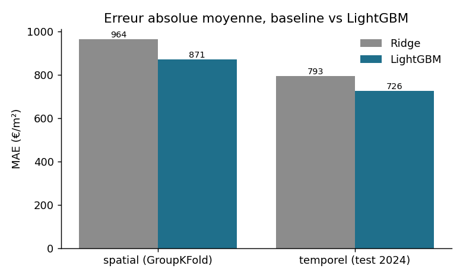
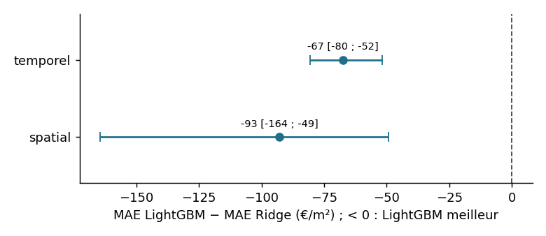
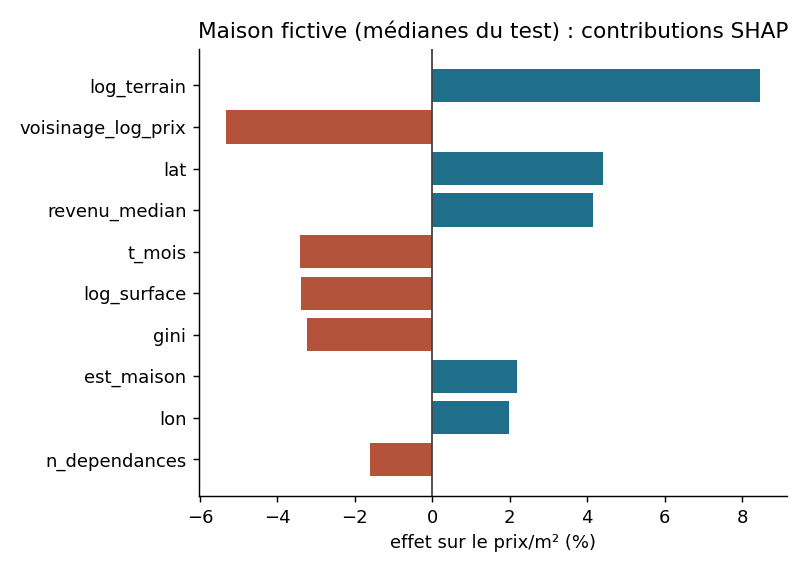
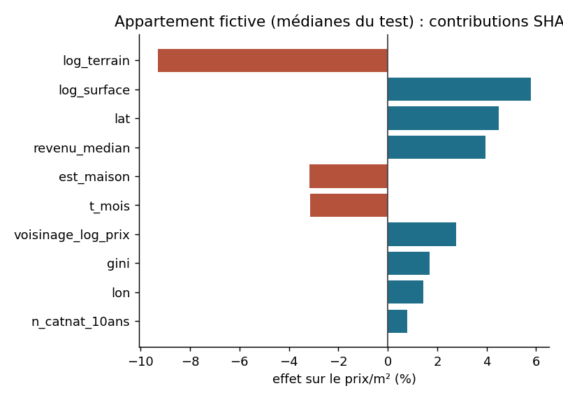
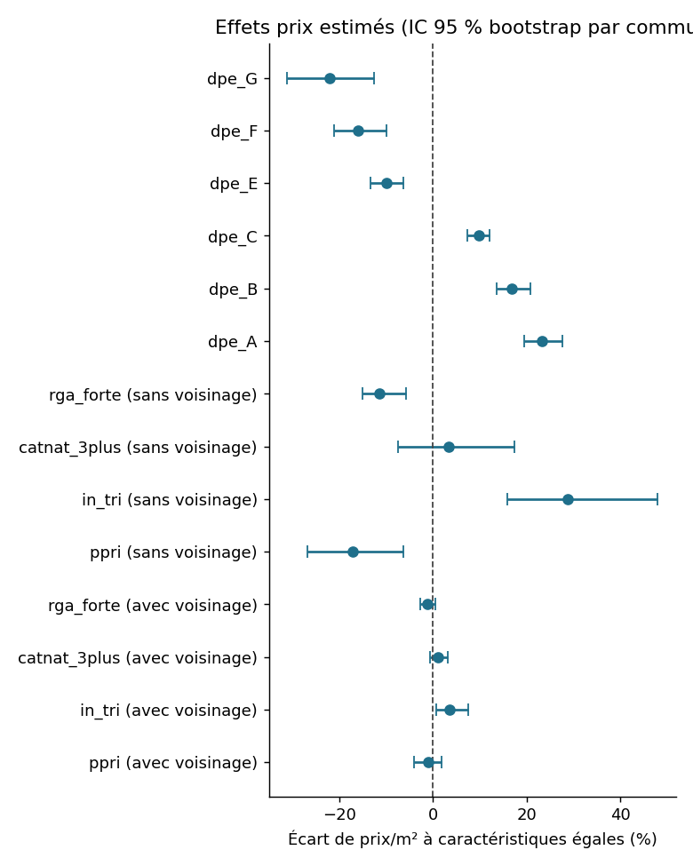

# Modèle de prix/m² — rapport du sprint 3

Entraîné le 2026-11-16 par `python -m atlas_pipelines.ml.train` ; tous les chiffres
viennent de [results.json](results.json) (aucune saisie manuelle). Suivi MLflow :
`mlruns/ local, expérience atlas-prix-m2, run e0ebb5d7cca941e09e5d7258d2c90223`.
Effets, erreurs par type, exemples et rapport recalculés le 2026-11-16 par `python -m atlas_pipelines.ml.rerender`, **sans réentraînement** (modèle rechargé, résidus du test 2024 vérifiés identiques).

## Données
- Gironde (33), DVF 2021-2024 (2021 = second semestre seulement),
  78 358 ventes de logements, 530 communes, après
  exclusion de 1 291 maisons avec plus d'un hectare de terrain (le prix y paie
  surtout le foncier, data-contract §1). 91 % d'entre
  elles (1 173) sont dans des communes sans IRIS : l'exclusion retire surtout
  du rural, et la projection refuse un terrain de plus de 10 000 m².
- Cible : log(prix/m²). Métriques après retour en €/m².
- Variables : surface (log), pièces, terrain (log), dépendances, revenu médian et Gini
  de l'IRIS (manquants hors IRIS diffusés), exposition RGA, TRI, PPRI, arrêtés Cat-Nat
  des 10 ans avant la vente, prix de voisinage H3 (voir ci-dessous), longitude,
  latitude, mois. Le DPE n'est pas une variable : 7,5 %
  des ventes seulement ont un DPE rattaché, dont 93,8 %
  de maisons.
- **Voisinage sans fuite** : médiane lissée du log-prix des 30 ventes du même type les
  plus récentes de l'anneau H3 r7, **strictement antérieures** à la vente et prises
  dans le **seul ensemble d'entraînement** du pli.
- Longitude/latitude : gardées, car elles donnent au modèle la position d'une commune
  jamais vue quand l'anneau H3 n'a pas de vente antérieure ; elles ne contiennent aucun prix.

## Protocole
- **Temporel** : entraînement ≤ 2023 (60 940 ventes), test 2024
  (17 418 ventes). Optuna (30 essais, GroupKFold 3 plis par
  commune sur le train seul).
- **Spatial** : GroupKFold 5 plis par commune sur toutes les années ; Optuna
  (12 essais) refait dans chaque pli d'entraînement (validation imbriquée).
- **Limite connue (hyperparamètres)** : dans les plis internes d'Optuna et dans le choix
  global / par type, la variable de voisinage est calculée une fois sur tout l'ensemble
  d'entraînement, sans être recalculée par pli interne. Les scores de test finaux n'en
  sont pas affectés (voisinage recalculé sur le seul train) ; seul le choix des
  hyperparamètres est optimiste. Correction (réentraînement) reportée.
- **Un modèle global ou un par type ?** MAE GroupKFold sur le train ≤ 2023, paramètres
  par défaut : global 852 €/m², par type 876
  €/m² → **global**.
- Zones : « commune à IRIS » (≥ ~5 000 habitants, découpée par l'INSEE) contre
  « commune sans IRIS » ; c'est une approximation urbain/rural, pas la grille de densité.

## Résultats
### Test temporel (2024)
| Groupe | Ventes | MAE Ridge | MAE LightGBM | MAPE Ridge | MAPE LightGBM | R² Ridge | R² LightGBM |
|---|---:|---:|---:|---:|---:|---:|---:|
| Toutes | 17 418 | 793 | 726 | 24,8 % | 22,5 % | 0,620 | 0,656 |
| Appartement | 7 382 | 727 | 638 | 18,9 % | 17,0 % | 0,580 | 0,664 |
| Maison | 10 036 | 842 | 790 | 29,2 % | 26,6 % | 0,629 | 0,653 |
| commune sans IRIS | 5 658 | 630 | 584 | 32,3 % | 28,7 % | 0,592 | 0,636 |
| commune à IRIS | 11 760 | 872 | 794 | 21,2 % | 19,5 % | 0,576 | 0,616 |

### Validation spatiale (communes jamais vues)
| Groupe | Ventes | MAE Ridge | MAE LightGBM | MAPE Ridge | MAPE LightGBM | R² Ridge | R² LightGBM |
|---|---:|---:|---:|---:|---:|---:|---:|
| Toutes | 78 358 | 964 | 871 | 27,0 % | 23,4 % | 0,414 | 0,519 |
| Appartement | 32 161 | 889 | 834 | 21,5 % | 19,1 % | 0,395 | 0,421 |
| Maison | 46 197 | 1 016 | 897 | 30,9 % | 26,5 % | 0,416 | 0,543 |
| commune sans IRIS | 25 796 | 763 | 648 | 36,4 % | 29,5 % | 0,381 | 0,522 |
| commune à IRIS | 52 562 | 1 062 | 980 | 22,5 % | 20,5 % | 0,323 | 0,441 |

## Porte bloquante : PASSÉE
Différence de MAE LightGBM − Ridge, bootstrap par commune (paire) :
- temporel : −67 €/m² (−8,5 %), IC 95 % [−80 ; −52] (2 000 tirages, 486 communes) : **significatif**
- spatial : −93 €/m² (−9,6 %), IC 95 % [−164 ; −49] (2 000 tirages, 530 communes) : **significatif**

## Explications SHAP
Importance globale (moyenne |SHAP| en log-prix, 3 000 ventes de test tirées au hasard) :
`voisinage_log_prix` 0,171, `log_terrain` 0,090, `log_surface` 0,087, `lon` 0,066, `gini` 0,061, `revenu_median` 0,060, `lat` 0,046, `t_mois` 0,031.

Exemples locaux sur des **biens fictifs** (aucune vente réelle, ADR 0005) :
- **Maison fictive** (surface 94 m², 4 pièces ; chaque variable = médiane des ventes maison du test) : base 3 480 €/m² → prédiction 3 589 €/m². Principales contributions : `log_terrain` 8,5 %, `voisinage_log_prix` −5,3 %, `lat` 4,4 %, `revenu_median` 4,1 %, `t_mois` −3,4 %.
- **Appartement fictif** (surface 50 m², 2 pièces ; chaque variable = médiane des ventes appartement du test) : base 3 480 €/m² → prédiction 3 668 €/m². Principales contributions : `log_terrain` −9,3 %, `log_surface` 5,8 %, `lat` 4,5 %, `revenu_median` 3,9 %, `est_maison` −3,2 %.

## Effets prix des risques et du DPE (entrée de la projection 2050)
Régression hédonique sur log(prix/m²), contrôles : surface, pièces, terrain, type,
année, revenu et Gini IRIS, avec ou sans le prix de voisinage H3 antérieur. IC
bootstrap par commune. Ce sont des **associations**, pas des effets causaux.

Risques (ventes ayant un prix de voisinage), publiés comme **deux bornes** :

**Avec contrôle de voisinage** (borne basse en valeur absolue). Les risques sont
communaux et le prix de voisinage est fait des ventes de la même zone, exposées aux
mêmes risques : il absorbe une partie de l'effet.

| Terme | Écart central | IC 95 % | Ventes | Communes |
|---|---:|---:|---:|---:|
| `ppri` | −1,0 % | [−4,1 % ; 1,7 %] | 78 229 | 530 |
| `in_tri` | 3,5 % | [0,6 % ; 7,5 %] | 78 229 | 530 |
| `catnat_3plus` | 1,1 % | [−0,7 % ; 3,2 %] | 78 229 | 530 |
| `rga_forte` | −1,2 % | [−2,7 % ; 0,6 %] | 78 229 | 530 |

**Sans contrôle de voisinage** (borne haute). Le coefficient mêle l'effet du risque et
tout ce qui distingue les communes exposées (bord de l'eau, centre urbain, etc.) : il
est confondu par la localisation, au point de changer de signe pour le TRI.

| Terme | Écart central | IC 95 % | Ventes | Communes |
|---|---:|---:|---:|---:|
| `ppri` | −17,2 % | [−26,7 % ; −6,3 %] | 78 229 | 530 |
| `in_tri` | 28,8 % | [15,8 % ; 47,8 %] | 78 229 | 530 |
| `catnat_3plus` | 3,3 % | [−7,5 % ; 17,4 %] | 78 229 | 530 |
| `rga_forte` | −11,4 % | [−15,0 % ; −5,8 %] | 78 229 | 530 |

DPE, classe D en référence, avec contrôle de voisinage
(5 536 maisons appariées sur 5 905
ventes appariées, échantillon non représentatif) :

| Terme | Écart central | IC 95 % | Ventes | Communes |
|---|---:|---:|---:|---:|
| `dpe_A` | 23,3 % | [19,4 % ; 27,5 %] | 5 536 | 250 |
| `dpe_B` | 16,9 % | [13,6 % ; 20,8 %] | 5 536 | 250 |
| `dpe_C` | 9,7 % | [7,2 % ; 12,0 %] | 5 536 | 250 |
| `dpe_E` | −9,9 % | [−13,3 % ; −6,4 %] | 5 536 | 250 |
| `dpe_F` | −16,0 % | [−21,1 % ; −9,9 %] | 5 536 | 250 |
| `dpe_G` | −22,0 % | [−31,1 % ; −12,6 %] | 5 536 | 250 |

Répartition des classes de ces maisons : A 8,1 %, B 7,6 %, C 35,6 %, D 27,9 %, E 13,3 %, F 5,1 %, G 2,4 %. Le modèle de prix n'utilisant
pas le DPE, sa prédiction correspond à ce mix : la projection applique
β_classe − Σ part·β. Rénover en D vaut ainsi −3,2 % par
rapport au prix estimé (point central), et non 0.

## Exemple de projection 2050
**Bien fictif** : maison « type », médianes des maisons du test 2024 situées dans des communes **sans PPRI** ; 96 m², terrain 762 m², prix estimé 3 748 €/m² ; risques actuels : `rga_forte`. Supposée en classe G.

Euros constants, sans tendance de marché ; méthode : docs/methodology.md. Erreur du
modèle tirée dans les résidus du test 2024 **du même type de bien** (P10 / P90 :
appartements −23,2 % / +26,9 % ; maisons −32,9 % / +37,4 %). L'hypothèse de nouveau risque est une **sensibilité, non
causale** : la fourchette publiée va du P10 le plus bas au P90 le plus haut des deux
bornes.

| Hypothèse | €/m² P10 | P50 | P90 | Bornes du risque (€/m²) | Location interdite depuis | Non inclus |
|---|---:|---:|---:|---|---:|---|
| G, statu quo, 2050 | 1 870 | 2 859 | 3 928 | — | 2025 | tendance du marché (euros constants) ; climat RCP 4.5 / 8.5 (DRIAS non disponible) |
| G rénovée en D, 2050 | 2 409 | 3 665 | 4 988 | — | 2025 | tendance du marché (euros constants) ; climat RCP 4.5 / 8.5 (DRIAS non disponible) ; coût de la rénovation |
| G, statu quo, si la commune entrait en PPRI (sensibilité, non causal) | 1 535 | 2 581 | 3 889 | sensibilité, non causal : avec voisinage 1 849 à 3 889 (P50 2 832) ; sans voisinage 1 535 à 3 290 (P50 2 364) | 2025 | tendance du marché (euros constants) ; climat RCP 4.5 / 8.5 (DRIAS non disponible) |
| G, statu quo, RCP 8.5 | refus explicite : Scénario rcp85 2050 demandé sans données DRIAS (accès bloqué : compte requis). La projection climatique n'est pas calcul… | | | | | |

## Limites
- Gironde seule ; les départements 13 et 59 ne sont pas encore ingérés.
- Le gold a été reconstruit sur 2021-2024 : les bornes d'outliers (IQR par commune et
  type) portent maintenant sur 4 ans, d'où un léger écart avec les effectifs 2024 du
  sprint 2.
- PPRI et TRI sont l'état actuel (GASPAR ne donne pas de date d'effet exploitable) :
  pour une vente de 2021, un PPRI approuvé ensuite est une information future.
- Les ventes d'une même commune restent corrélées ; les IC par commune en tiennent
  compte, pas la corrélation entre communes voisines.
- Hyperparamètres choisis avec un voisinage non recalculé dans les plis internes
  (voir Protocole) : choix optimiste, scores de test non affectés.
- Méthode et usage de la projection : [docs/methodology.md](../docs/methodology.md).
